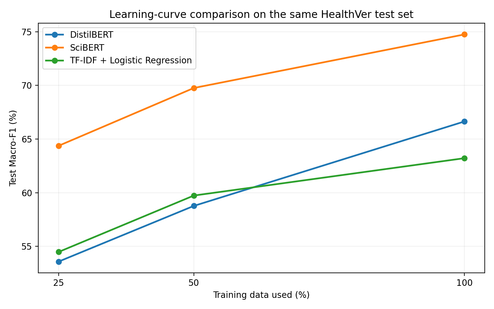
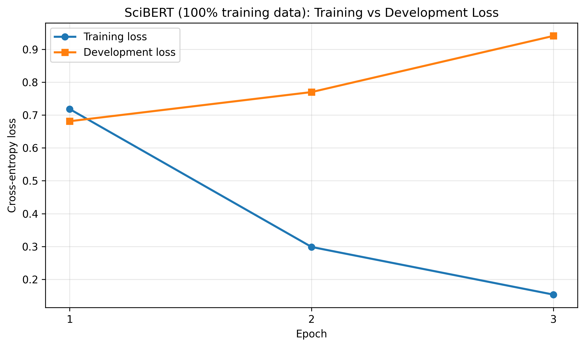

# Deep Learning Midterm - Health Claim Verification

**Project:** Comparative Analysis of Transformer Models for Health Claim Verification: Accuracy, Data Efficiency, and Error Patterns  
**Course:** Deep Learning (midterm, October 2026)

## Project overview

I fine-tuned **SciBERT** and **DistilBERT** to classify HealthVer claim–evidence pairs as **SUPPORT**, **REFUTE**, or **NEUTRAL**. I compared both transformers against a **TF-IDF + Logistic Regression** baseline. To examine data efficiency, I repeated the comparison using 25%, 50%, and 100% of the available training data, for **nine experiments** in total.

I also examined cross-entropy loss curves, confusion matrices, and selected misclassifications to understand what the models learned and where they struggled. The accompanying report explains transformer architecture, preprocessing, loss functions, backpropagation, and the main findings.

## Results

These are my saved **held-out test-set** results; the notebook contains the underlying training and evaluation implementation.

| Model | Training fraction | Accuracy (%) | Macro-F1 |
|---|---:|---:|---:|
| SciBERT | 25% | 66.54 | 0.6437 |
| SciBERT | 50% | 71.53 | 0.6976 |
| **SciBERT** | **100%** | **76.14** | **0.7475** |
| DistilBERT | 25% | 56.12 | 0.5358 |
| DistilBERT | 50% | 60.34 | 0.5877 |
| DistilBERT | 100% | 67.69 | 0.6664 |
| TF-IDF + Logistic Regression | 25% | 58.69 | 0.5448 |
| TF-IDF + Logistic Regression | 50% | 63.30 | 0.5974 |
| TF-IDF + Logistic Regression | 100% | 66.43 | 0.6322 |

An interesting finding was that SciBERT's lowest development cross-entropy loss occurred at epoch **1**, but its highest development **Macro-F1** occurred at epoch **2**. I selected model checkpoints by development Macro-F1.

## Repository structure

- `Midterm_Adv_Deep_Learning.ipynb` - the complete annotated Colab notebook, including saved outputs
- `results/all_results.csv` - summary metrics from all nine experiments
- `results/history_*.csv` - epoch-by-epoch histories for the six transformer runs
- `results/experiment_config.json` - recorded hyperparameters and environment
- `results/dataset_sha256.csv` - checksums of the downloaded dataset files
- `figures/` - plots created from the saved experimental results
- `report/HealthVer_Midterm_Report.tex` - LaTeX report source; submit the compiled report PDF separately
- `requirements.txt` - primary Python dependencies

## Running the notebook

1. Open `Midterm_Adv_Deep_Learning.ipynb` in **Google Colab** (GitHub notebook viewer also offers an **Open in Colab** option).
2. Select **Runtime → Change runtime type → T4 GPU** (or another compatible GPU).
3. Run the cells from top to bottom. The first installation cell installs the necessary packages. An optional dependency warning about preinstalled Gradio/Diffusers does not necessarily prevent this project from running; check the subsequent library-import cell.
4. The notebook downloads the official HealthVer train/dev/test CSVs from the original repository if they are missing. It writes outputs to `MyDrive/HealthVer_Midterm/final_results` when run in Colab.
5. If saved results already exist in that Drive folder, experiment cells intentionally print **`Skipping completed`** and reuse the results. For an independent retraining, use a fresh output directory or first back up the existing files and remove the cached experiment results.
6. Training from scratch may take considerable GPU time and may produce small numerical differences depending on software/hardware and nondeterminism.

The **last plotting cell** has been made portable by reading the SciBERT history file from the notebook's configured `RESULTS_DIR` rather than a hardcoded Colab path. No training or evaluation logic has been changed for the repository copy.

## Important notes

- The official HealthVer data and original labels are credited to the dataset creators; this repository intentionally does not duplicate their full data files. The notebook downloads them from the source: <https://github.com/sarrouti/HealthVer>.
- Model checkpoints are **not** uploaded to GitHub because their weights are large. The notebook contains the training code and saves the full-data fine-tuned transformer checkpoints in the configured Google Drive folder when trained. The saved outputs here allow inspection of the reported summary metrics and training histories.
- The available evaluation uses one random seed, and repeated claim–evidence pairs exist within some original data splits. The accompanying report discusses these limitations.
- This is a course comparison/analysis exercise, **not** a medical decision tool or a claim of a new state-of-the-art result.

## Main references

- Sarrouti et al. (2021), *Evidence-based Fact-Checking of Health-related Claims*, Findings of EMNLP: <https://aclanthology.org/2021.findings-emnlp.297/>
- Beltagy et al. (2019), *SciBERT: A Pretrained Language Model for Scientific Text*, EMNLP-IJCNLP: <https://aclanthology.org/D19-1371/>
- Wadden et al. (2020), *Fact or Fiction: Verifying Scientific Claims*, EMNLP: <https://aclanthology.org/2020.emnlp-main.609/>
